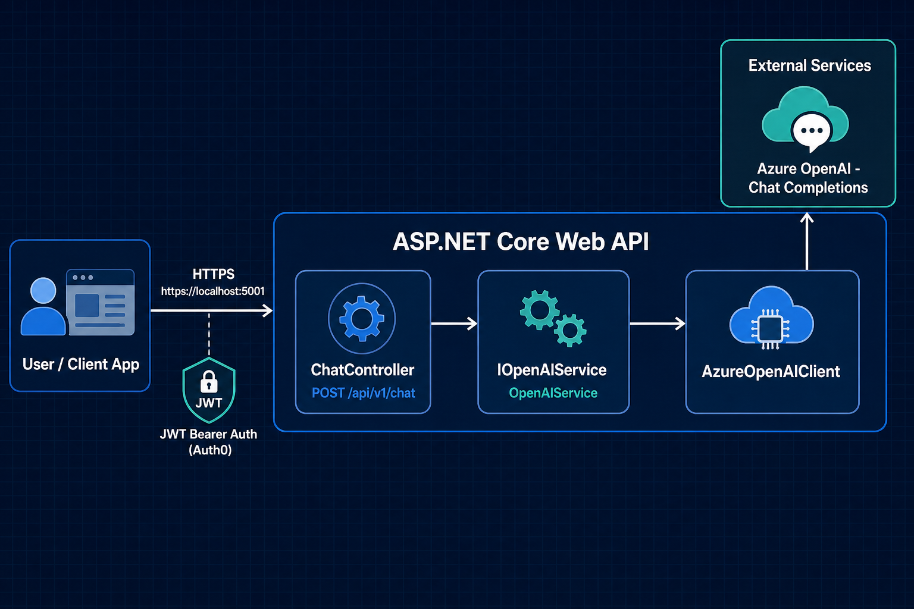

# OpenAi.Api (Azure OpenAI) 🤖
API ASP.NET Core (.NET 10) que expone un endpoint de chat y llama a **Azure OpenAI** mediante el SDK [`Azure.AI.OpenAI`](https://www.nuget.org/packages/Azure.AI.OpenAI). Sigue la estructura y convenciones de [TemplateApi.Net10](https://github.com/agustinafassina/TemplateApi.Net10).

## Requisitos 📋
- [.NET SDK 10](https://dotnet.microsoft.com/download)
- Un recurso de Azure OpenAI con un deployment de modelo de chat
- Un emisor JWT (Auth0 u otro) para llamar al endpoint de chat

## Arquitectura 🏗️
```
OpenAi.Api         → controllers, validators (FluentValidation), middleware, Program.cs
OpenAi.Services    → lógica de aplicación (IOpenAIService)
OpenAi.Repository  → acceso a Azure OpenAI (IChatCompletionRepository, ChatClient)
OpenAi.Models      → settings y excepciones compartidas
OpenAi.Api.Tests   → unit tests (xUnit + Moq)
```
Dirección de dependencias: `Api → Services → Repository → Models`. Solo `OpenAi.Repository` conoce el SDK de Azure OpenAI; traduce sus errores a `ExternalServiceException`.

La DI se registra con `AddRepositories(configuration)` y `AddApplicationServices()`. El `ChatClient` es singleton (el SDK está pensado para reutilizarse).



## Configuración ⚙️
### Azure OpenAI
```json
"OpenAISetting": {
  "Endpoint": "https://TU-RECURSO.openai.azure.com/",
  "DeploymentName": "nombre-del-deployment",
  "ApiKey": "TU_CLAVE"
}
```
Los tres valores son obligatorios y se validan **al arrancar**: si falta alguno (o `Endpoint` no es una URL), la app no levanta y el log indica qué campo falta.

En desarrollo, guarda la clave con **User Secrets** (el proyecto ya tiene `UserSecretsId`):
```bash
dotnet user-secrets --project OpenAi.Api set "OpenAISetting:ApiKey" "..."
```
Desplegado, usa variables de entorno (`OpenAISetting__ApiKey`) o un secret store (Key Vault / Secrets Manager).

### JWT (Auth0App1 / Auth0App2) 🔐
**Todos los endpoints requieren un token válido** de cualquiera de los dos emisores (fallback policy). Excepción: `/health`, que es público.

```json
"Auth0App1": { "Issuer": "https://tu-dominio.auth0.com/", "Audience": "tu-api-audience" },
"Auth0App2": { "Issuer": "https://otro-emisor/", "Audience": "otra-audience" }
```
Variables de entorno equivalentes: `Auth0App1__Issuer`, `Auth0App1__Audience`, etc. Se validan issuer, audience, lifetime y firma (clock skew de 1 minuto). Fuera de Development, el `Issuer` debe ser HTTPS.

### CORS 🌐
Orígenes permitidos en `Cors:AllowedOrigins`. Por defecto vacío (nada permitido); en Development se permite `http://localhost:8000`.

### Rate limiting ⏱️
El endpoint de chat permite `RateLimiting:Chat:PermitLimit` requests por minuto **por usuario** (default 20), para acotar el gasto en Azure OpenAI. Al superarlo responde `429`.

## API 📡
| Método | Ruta | Auth | Cuerpo |
|--------|------|------|--------|
| `POST` | `/api/v1/Chat` | Bearer | `{ "message": "tu pregunta" }` (1–4000 caracteres) |
| `GET` | `/health` | — | — |

Respuestas de `POST /api/v1/Chat`:

| Código | Cuándo |
|--------|--------|
| `200` | `{ "reply": "texto generado" }` |
| `400` | `message` vacío o demasiado largo (ValidationProblemDetails) |
| `401` | Sin token o token inválido |
| `429` | Rate limit superado |
| `502` | Azure OpenAI respondió con error o sin texto |
| `503` | Azure OpenAI no disponible o con throttling (incluye `Retry-After` si Azure lo envía) |

Todos los errores son **ProblemDetails** con `traceId` para correlacionar con los logs; nunca incluyen mensajes internos. Los logs registran metadata (tokens usados, finish reason), no el contenido de preguntas ni respuestas.

[OpenAi.Api/OpenAi.Api.http](OpenAi.Api/OpenAi.Api.http) tiene requests de ejemplo.

### Swagger
Solo en Development: `http://localhost:5142/swagger` o `https://localhost:7137/swagger`.

## Ejecución local ▶️
```bash
dotnet restore
dotnet build
dotnet run --project OpenAi.Api
```

## Tests 🧪
`OpenAi.Api.Tests` usa **xUnit** y **Moq**. Convención de nombres: `MethodName_Scenario_ExpectedBehavior`.

```bash
dotnet test
```

Cobertura:
- `AzureOpenAIChatRepository`: respuesta del modelo, contenido vacío, mapeo de errores de Azure (throttling + `Retry-After`, errores 4xx) — con `ChatClient` mockeado
- `OpenAIService`: reply, reply vacío → `null`, pregunta vacía, propagación de `CancellationToken` y excepciones
- `ChatController`: `200`, `502` por reply vacío, `400` por validación
- `QuestionRequestValidator`: requerido y largo máximo
- `GlobalExceptionHandler`: `503`/`502`/`500`, `Retry-After`, `traceId`, sin fuga de mensajes, cliente desconectado
- `OpenAISetting`: validación de configuración

## Docker 🐳
```bash
docker build -t openai-api .
docker run -d -p 8787:80 \
  -e OpenAISetting__Endpoint=https://TU-RECURSO.openai.azure.com/ \
  -e OpenAISetting__DeploymentName=... \
  -e OpenAISetting__ApiKey=... \
  -e Auth0App1__Issuer=... -e Auth0App1__Audience=... \
  --name openai-api openai-api
```
No incluyas claves en la imagen. No uses `ASPNETCORE_ENVIRONMENT=Development` en entornos desplegados.

## CI/CD 🚀
`azure-pipelines-acr.yml` (Azure Container Registry) y `azure-pipelines-ecr.yml` (AWS ECR) corren `dotnet test` y publican los resultados antes de construir y subir la imagen. Si un test falla, no se publica la imagen.

## Licencia 📄
Proyecto personal de Agustina Fassina. Distribuido bajo licencia [MIT](https://opensource.org/licenses/MIT).
